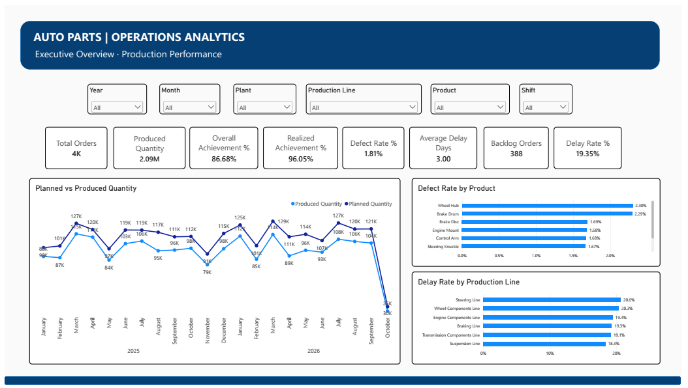
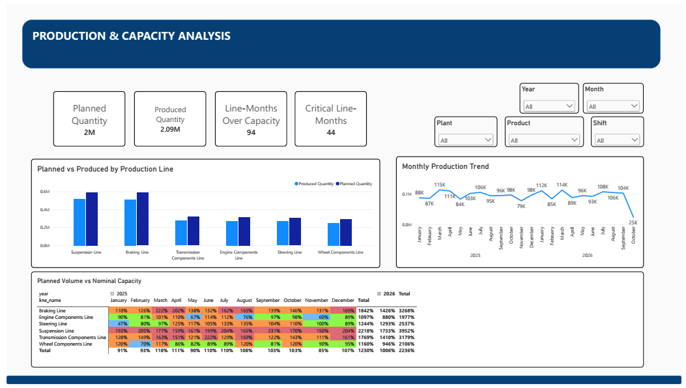
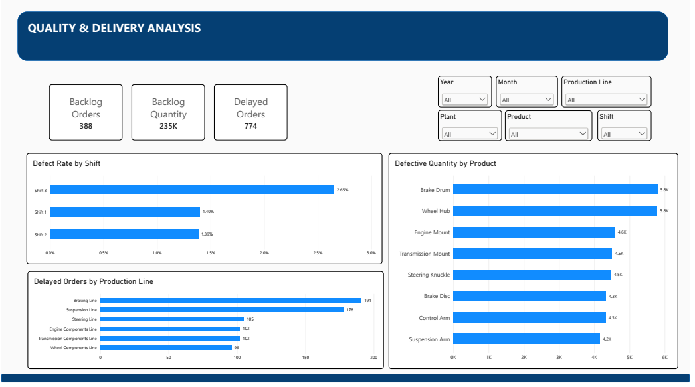
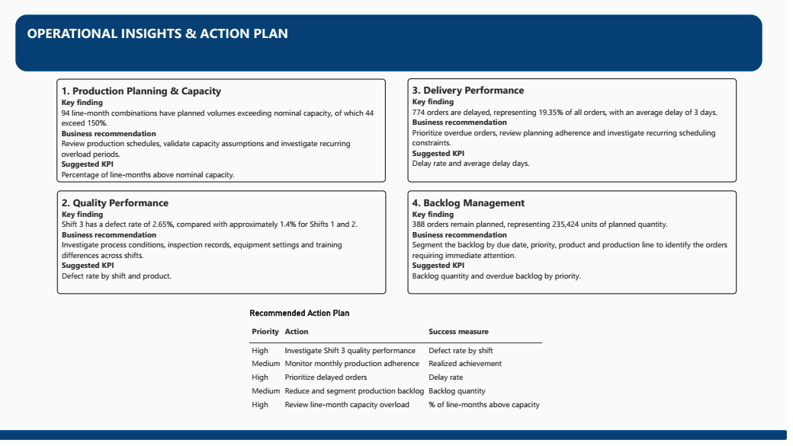

# AutoParts Manufacturing — Production & Operations Analytics

## Project Overview

This project analyzes a fictional automotive parts manufacturing operation using PostgreSQL and Power BI. The objective is to monitor production performance, capacity planning, product quality, and delivery reliability through interactive dashboards and operational KPIs.

The project simulates a manufacturing environment with multiple plants, production lines, products, shifts, and production orders.

## Business Objectives

- Monitor planned versus actual production.
- Evaluate production achievement and nominal capacity utilization.
- Identify patterns in defects across products and shifts.
- Analyze delayed orders and production backlog.
- Translate operational data into actionable business recommendations.

## Tools & Technologies

- **PostgreSQL** — data storage and SQL analysis
- **Power BI Desktop** — interactive dashboards and data visualization
- **DAX** — KPI calculations and analytical measures
- **Data modeling** — relationships between production orders, products, production lines, and calendar data

## Dataset

The synthetic dataset contains 4,000 production orders dated from January 2025 through September 2026. It includes planned and produced quantities, defective units, production dates, order status, product, production line, and shift.

All data is fictional and intended for portfolio and analytical demonstration purposes.

## Dashboard Preview

### 1. Executive Overview

### 2. Production & Capacity

### 3. Quality & Delivery

### 4. Insights & Recommendations

## Key Findings

- **Production achievement:** 86.68% across all orders, including orders that remain planned.
- **Realized achievement:** approximately 96.06% when considering completed and delayed orders.
- **Delivery performance:** 774 delayed orders, representing 19.35% of all orders.
- **Quality:** an overall defect rate of 1.81%.
- **Shift analysis:** Shift 3 has a defect rate of 2.65%, compared with approximately 1.4% for Shifts 1 and 2.
- **Capacity planning:** 94 line-month combinations exceed nominal capacity, including 44 that exceed 150%.

These findings describe patterns in synthetic data. They do not establish the underlying causes of production delays, defects, or capacity constraints.

## Dashboard Pages

1. **Executive Overview** — production, achievement, delays, defects, and backlog KPIs.
2. **Production & Capacity** — planned versus produced quantities, monthly trends, and nominal capacity utilization.
3. **Quality & Delivery** — defect analysis by shift and product, delayed orders, and backlog.
4. **Insights & Recommendations** — operational findings, suggested actions, and success metrics.

## Recommendations

- Investigate quality differences across shifts and products.
- Review production schedules for line-month combinations with planned volumes above nominal capacity.
- Prioritize delayed orders and analyze recurring scheduling constraints.
- Segment backlog by due date, priority, product, and production line.
- Track operational KPIs regularly to support continuous improvement.

## Limitations

This is a synthetic-data portfolio project. Capacity utilization compares planned volume with nominal monthly capacity; values above 100% indicate a planning signal to investigate, not proof of actual production above physical capacity.

## Author

Data Analytics Portfolio Project — focused on manufacturing operations, production planning, ERP data, and process improvement.
